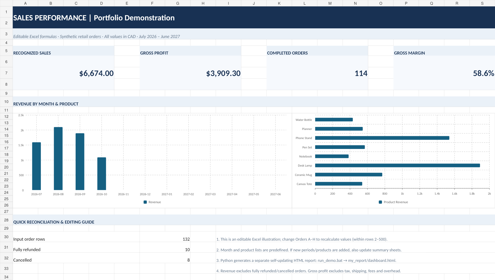

# Offline Sales Reporting Automation | Python + Excel Portfolio



**Engineering portfolio demonstration — 132 fictional retail orders. No real client data or prior paid work is represented.**

A practical, offline workflow that validates an order export and automatically generates a **new HTML dashboard** and Excel-ready CSV summaries every time it runs. An independent, formula-driven **editable Excel sample** is also included.

## Deliverables

| Feature | Status |
|---|---|
| CSV parsing, duplicate/invalid row checks | ✅ Implemented and tested |
| Automatic monthly & product CSV summaries | ✅ Implemented and tested |
| **Auto-generated HTML dashboard** for new CSV data | ✅ Implemented and tested |
| Offline operation, Python standard library only | ✅ Implemented and tested |
| Editable sample `.xlsx` with charts and Excel formulas | ✅ Created and checked |
| Python-to-Excel `.xlsx` automatic refresh | **Not implemented** (do not promise this to clients) |
| Full/partial refund accounting, taxes, shipping, multiple currencies | **Out of scope** |

## One-click Windows demo

Requires **Python 3.9+** installed, with `py` or `python` available on PATH.

1. Extract this ZIP; **do not run the script from inside the ZIP viewer**.
2. Double-click **`run_demo.bat`**.
3. Your browser opens **`my_report/dashboard.html`** (or open it manually).
4. Open `Editable_Excel_Dashboard.xlsx` separately in Microsoft Excel to inspect the formulas and charts.

Python installation: https://www.python.org/downloads/ (if you do not have it already).

### Windows command line

```powershell
py -3 analyze_orders.py sample_orders.csv --out my_report --demo
```

### macOS / Linux

```bash
./run_demo.sh
```

### New CSV dataset

```bash
python analyze_orders.py your_anonymized_orders.csv --out my_report
```

Re-running that command **overwrites the six generated report files** inside `my_report` with up-to-date results from the input CSV. The dashboard needs only a browser; it is a single offline HTML file with no external assets. Open/refresh the HTML file after each run.

**Do not place your real customer records inside this public repository.** Use a separate private folder and output destination, such as `--out private_report`.

## Input format (required columns)

```csv
order_id,date,product,category,quantity,unit_price,unit_cost,status
ORD-0001,2026-10-01,Desk Lamp,Home,2,44.00,22.00,Completed
ORD-0002,2026-10-01,Notebook,Stationery,1,12.00,4.10,Refunded
```

- `date`: ISO format `YYYY-MM-DD`; `quantity`: integer greater than zero.
- `unit_price` / `unit_cost`: CAD currency amounts, nonnegative, **up to two decimal places**.
- `status`: `Completed`, `Refunded`, or `Cancelled` (case-insensitive).
- Each `order_id` must be present and unique. Data columns use **exact header names**.
- Empty/invalid rows are rejected and listed by input line number. A duplicate is rejected after the first accepted use of its ID.
- Completed orders recognize `quantity × unit_price` as sales, `quantity × unit_cost` as COGS; gross profit is their difference. Refunded and cancelled orders recognize **zero** sales/costs. Refunds must be fully refunded; no partial-refund behavior.

## Generated output

```text
my_report/
├── dashboard.html          Automatically regenerated dashboard, open locally in a browser
├── clean_orders.csv        Validated orders + calculation columns
├── monthly_summary.csv     Completed/refunded/cancelled breakdown per month
├── product_summary.csv     Sold units, revenue, gross profit by product
├── quality_report.txt      Input validation counts and rejected row numbers
└── report_metadata.json    Machine-readable reconciled totals
```

The `example_output/` folder contains a committed known-good sample of these six files.

## Verified fictional demonstration

| Metric | Value |
|---|---:|
| Valid orders | 132 |
| Completed | 114 |
| Fully refunded | 10 |
| Cancelled | 8 |
| Rejected | 0 |
| Recognized sales | CAD 6,674.00 |
| Gross profit (before overhead etc.) | CAD 3,909.30 |

**Tests:**

```bash
python -m unittest discover -s tests -v
```

Tests cover new-file refresh, summary reconciliation, invalid rows, duplicate orders, dates and statuses, formula injection, unsafe HTML strings and failure with no accepted orders. No pip installs are needed to run or test the Python workflow.

## Separate editable Excel workbook

`Editable_Excel_Dashboard.xlsx` has five sheets: **Start Here**, **Dashboard**, **Orders**, **Monthly Summary** and **Product Summary**. It includes editable Excel formulas covering Orders rows 2–500. When you edit the input values within those rows, formulas and charts recalculate in Excel. Month categories are preset for July 2026–June 2027 and product names for the eight demo products; new months and names must be added to the respective summary sheets.

**The workbook is not connected to the Python program.** For a fully updated report from a different CSV file, use the generated HTML dashboard or agree on a separate client-specific Excel integration scope.

## Privacy and business limitations

The calculation is operational, not formal bookkeeping. It excludes partial refunds, shipping, currency conversion, tax, processor fees, discount allocations, chargebacks, inventory valuation and net profit. Client datasets should be processed locally, only with permission, and not shared to public GitHub or AI services without explicit authorization.

This project is a portfolio proof of concept, not a production-certified financial system. Do not claim that it saved a business time or generated real revenue.
